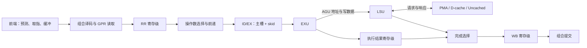

# RV32 · 2026-09-12

[返回归档目录](../README.md)

原始时间统一标为 UTC；正文保留当时讨论，不作为当前设计或测量结论。

---

## 0274 · 用户

2026-09-12 11:57:04.750 UTC

<environment_context>
  <current_date>2026-09-12</current_date>
  <timezone>Europe/Brussels</timezone>
  <filesystem><workspace_roots><root>/home/yong/ysyx</root></workspace_roots><permission_profile type="managed"><file_system type="restricted"><entry access="read"><special>:root</special></entry><entry access="write"><path>/home/yong/ysyx</path></entry><entry access="write"><special>:slash_tmp</special></entry><entry access="write"><special>:tmpdir</special></entry><entry access="read"><path>/home/yong/ysyx/.git</path></entry><entry access="read"><path>/home/yong/ysyx/.agents</path></entry><entry access="read"><path>/home/yong/ysyx/.codex</path></entry></file_system></permission_profile></filesystem>
</environment_context>

---

## 0275 · 用户

2026-09-12 11:57:04.945 UTC

现在你已经把最新的代码push到github远程了吗？就是这个用于面试的分支

---

## 0276 · 助手（进度）

2026-09-12 11:57:15.316 UTC

我核对一下 GitHub 上面试分支的提交，以及本地是否还有新的源码改动未发布。

---

## 0277 · 助手

2026-09-12 11:57:46.062 UTC

**是的，已经推送。我刚重新核对了 GitHub。**

- **面试分支**：[rv32-interview-20260911](https://github.com/roundeodo/ysyx/tree/rv32-interview-20260911)
- **远程提交**：`f7a8f256`
- 远程发布快照与当前本地源码一致，没有新的源码改动遗漏。
- MicroBench、ysyxSoC 的修改已作为依赖补丁上传，恢复脚本检查通过。

之后关于计时的讨论没有再次修改代码。远程保存的是发布快照，大体积综合产物和原开发历史仍保留在本地。

---

## 0278 · 用户

2026-09-12 12:02:49.460 UTC

现在分析一下当前CPU的架构，包括具体每个子模块的架构，我需要画出架构图，为后续的面试做准备

---

## 0279 · 助手（进度）

2026-09-12 12:02:58.165 UTC

我会按已发布的 RV32 面试版本梳理：先确认系统、流水线和存储通路，再逐个模块核对内部结构与握手关系，整理成可直接画图的分层架构图，并标出面试时需要解释的设计取舍。

---

## 0280 · 助手（进度）

2026-09-12 12:04:22.630 UTC

已确认，主图不能画成固定六级流水线：译码寄存级已经合并，EXU 把普通结果和访存请求送往两条不同的完成路径。另一个画图时很容易出错的地方是前递——实际数据选择发生在 ID/EX 寄存器之前，部分旧注释仍保留了较早的说法；我会以信号连接为准。

---

## 0281 · 助手（进度）

2026-09-12 12:08:15.518 UTC

缓存参数和总线边界也已核实：当前 I-Cache 是 256B、直接映射，D-Cache 是 256B、两路组相联；简历里“两路 I-Cache”属于可配置能力，不能当作当前配置。CLINT 位于处理器核外的本地系统中，计时器中断已经接入核内控制逻辑。我会在图中区分当前参数、可配置能力和仿真设施。

---

## 0282 · 助手（进度）

2026-09-12 12:09:31.441 UTC

已经找到几个面试时需要讲清楚的结构取舍：前递在 ID/EX 寄存器前完成；LSU 先寄存请求，再访问缓存；分支预测错误在执行结果寄存级后判断。这些寄存边界用于缩短组合路径，但也会增加相关指令或访存的等待时间。图中会同时标出这些边界和代价，避免只画模块名称却解释不了性能。

---

## 0283 · 助手（进度）

2026-09-12 12:17:07.705 UTC

逐模块核对已完成，正在把结果整理成七张可直接用于面试的图，并附上可修改的图源。另有一个需要如实说明的实现边界：FENCE.I 清理 D-cache 时若写回失败，目前只有仿真断言报告，尚未转换成软件可处理的架构异常；这部分不能描述成已经具备完整的异常恢复机制。

---

## 0284 · 助手（进度）

2026-09-12 12:23:27.407 UTC

七张图已经生成，目录中的 54 个模块定义也都已归入说明，区分了当前实例、仿真模块和保留实验。还确认了一个面积相关细节：I-cache 数据存储体采用低电平透明锁存器，D-cache 数据阵列采用上升沿触发器；两者虽然都是同步读接口，内部存储实现并不相同。这一点已经补进缓存图和模块说明。

---

## 0285 · 助手

2026-09-12 12:26:23.054 UTC

已经按 **RV32 面试分支 `rv32-interview-20260911`、`rv32-baseline` 配置**核对了实际代码，并整理成：

**[完整架构分析与逐模块说明](/home/yong/ysyx/ysyx-workbench-rv32-interview/npc/docs/interview/RV32_ARCHITECTURE_ATLAS.md)**

文档覆盖目录内的模块，说明了内部结构、寄存状态、接口、状态机和设计取舍，并附有 **7 张 SVG 架构图及可修改的 DOT 图源**。

当前 CPU 的准确定位是：**RV32I 单发射、顺序执行、顺序提交处理器，使用 Valid/Ready 弹性接口，带分支预测、分离式 I/D-cache、基础 M-mode 异常和定时中断，通过 AXI4 接入 ysyxSoC。**

主数据通路应这样理解：

**不能直接把它称为固定六级流水线。**“取指、译码、执行、访存、写回、提交”是功能划分；实际寄存边界如上，访存指令和普通指令走不同的完成路径。

各部分的结构和对应图如下：

| 部分 | 当前实现 | 架构图 |
|---|---|---|
| 系统集成 | 纯核、复位控制、I/D 读请求轮询仲裁、地址路由、本地 CLINT、SoC 接口映射；合并后最多一个读 burst 在途 | [系统图](/home/yong/ysyx/ysyx-workbench-rv32-interview/npc/docs/interview/figures/01-system.svg) |
| 流水线 | 组合 IDU；GPR 两读一写；RR 一项；ID/EX 主槽加 skid；执行结果和 WB 各一项；组合提交 | [流水线图](/home/yong/ysyx/ysyx-workbench-rv32-interview/npc/docs/interview/figures/02-pipeline.svg) |
| 前端 | 两级预测查询；BHT 16 项、BTB 总计 16 项/两路、RAS 4 项；IFU 请求队列两项、取指完成缓冲两项；tag 配对、epoch 过滤旧响应 | [前端图](/home/yong/ysyx/ysyx-workbench-rv32-interview/npc/docs/interview/figures/03-frontend.svg) |
| 执行与访存 | EXU 内含整数 ALU、分支、CSR 运算和 AGU；LSU 保存一个请求上下文，完成对齐检查、字节掩码、load 扩展及异常转换 | [执行图](/home/yong/ysyx/ysyx-workbench-rv32-interview/npc/docs/interview/figures/04-execute.svg) |
| I-cache | **256B、直接映射、16B/行**；同步查询、单活动缺失、AXI 四拍回填、Early Restart | [I-cache 图](/home/yong/ysyx/ysyx-workbench-rv32-interview/npc/docs/interview/figures/05-icache.svg) |
| D-cache | **256B、两路、16B/行**；阻塞式 Write-Back/Write-Allocate；脏行采集写回、回填、store 合并、clean，以及独立 uncached 通路 | [D-cache 图](/home/yong/ysyx/ysyx-workbench-rv32-interview/npc/docs/interview/figures/06-dcache.svg) |
| 控制与特权 | 冒险检测、串行化、分支恢复、CSR/PMU、定时中断排空受理、trap/mret、FENCE.I 维护 | [控制图](/home/yong/ysyx/ysyx-workbench-rv32-interview/npc/docs/interview/figures/07-control.svg) |

面试时尤其需要解释清楚以下取舍：

- **前递发生在 ID/EX 之前。**来源是当前 EXU、执行结果寄存级和 WB；当前没有直接从缓存响应前递 load 数据的通路。
- **LSU 先寄存请求。**它用入口延迟换取地址计算与存储访问之间的时序切分；单活动事务也限制了吞吐。
- **分支预测错误在执行结果寄存级之后判断。**这样拆开目标计算与预测比较，但增加恢复延迟。
- **Early Restart 只提前交付请求字。**I-cache 仍需收完整行，期间不能自由处理其他命中或缺失。
- **I/D-cache 的数据存储实现不同。**I-cache 使用写口寄存加低电平透明锁存阵列；D-cache 使用上升沿触发器阵列。同步读接口不代表已经使用 SRAM 宏。
- **CLINT 位于纯核之外，但中断链已经接通。**目前支持 M-mode 定时中断，外部中断和软件中断未实现。

还有一个需要明确的实现边界：**FENCE.I 清理 D-cache 时的写回失败，目前只有仿真断言报告，尚未转换为软件可处理的架构异常。**文档已经标明，面试时不能把这部分描述为完整的异常恢复能力。

建议先掌握系统图和流水线图，能够沿一条 ALU 指令、一条 load 指令讲完，再展开缓存、预测和中断。新增材料已保存在本地面试工作树，图源渲染及文档链接检查通过；本次没有重新运行综合或 train。

<oai-mem-citation>
<citation_entries>
MEMORY.md:118-133|note=[Keep RV32 scope and verify instantiated hardware]
</citation_entries>
<rollout_ids>
019f0573-8d80-77a0-9be3-faf6b14d90f1
</rollout_ids>
</oai-mem-citation>
