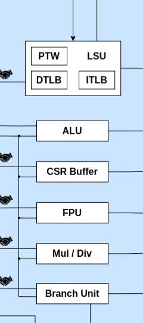

# RV32 · 2026-10-04

[返回归档目录](../README.md)

原始时间统一标为 UTC；正文保留当时讨论，不作为当前设计或测量结论。

---

## 1603 · 用户

2026-10-04 00:49:42.302 UTC

<environment_context>
  <current_date>2026-10-04</current_date>
  <timezone>Europe/Brussels</timezone>
  <filesystem><workspace_roots><root>/home/yong/ysyx</root></workspace_roots><permission_profile type="managed"><file_system type="restricted"><entry access="read"><special>:root</special></entry><entry access="write"><path>/home/yong/ysyx</path></entry><entry access="write"><special>:slash_tmp</special></entry><entry access="write"><special>:tmpdir</special></entry><entry access="read"><path>/home/yong/ysyx/.git</path></entry><entry access="read"><path>/home/yong/ysyx/.agents</path></entry><entry access="read"><path>/home/yong/ysyx/.codex</path></entry><entry access="read"><path>/home/yong/ysyx/.aws</path></entry></file_system></permission_profile></filesystem>
</environment_context>

---

## 1604 · 用户

2026-10-04 00:49:42.331 UTC

<external_codex_apps_open_page>{"page_id":null}</external_codex_apps_open_page>

---

## 1605 · 用户

2026-10-04 00:49:42.338 UTC

我问个问题，我看CVA6的execute stage有专门的branch unit,是专门做地址判断的吧？这样就不用使用ALU来做这个事情了吧？我们现在的设计中有这个吗？还有我看他们的CSR buffer也放在了这里，上面那个PTW DTLB ITLB应该是和部署操作系统有关的吧？页表？




---

## 1606 · 助手（进度）

2026-10-04 00:49:50.725 UTC

我会核对 CVA6 的 Branch Unit、CSR Buffer 和地址翻译结构，再对照我们当前 RV32 的执行路径，说明哪些功能已有、哪些没有。


---

## 1607 · 助手（进度）

2026-10-04 00:51:07.354 UTC

我们当前确实有独立于普通 ALU 运算选择的分支比较和目标计算逻辑，只是写在 EXU 内，没有单独命名为 Branch Unit。CVA6 的框图还需要对照源码看：模块画成独立方框，并不一定表示内部完全不共享比较电路。


---

## 1608 · 助手

2026-10-04 00:52:21.104 UTC

你的理解大体正确，但有一个关键细节：**CVA6 虽然有独立 Branch Unit，条件比较仍然可以由 ALU 完成。我们也已有分支执行逻辑，只是没有拆成独立模块。**

**1. Branch Unit 不只是计算地址，还负责解析分支和检查预测。**

处理分支通常需要完成这些事情：

| 功能 | 具体操作 |
|---|---|
| 判断条件 | 比较 `rs1`、`rs2`，判断 BEQ、BLT 等是否成立 |
| 计算目标 | B/JAL：`PC + imm`；JALR：`(rs1 + imm) & ~1` |
| 生成返回地址 | JAL/JALR 写回下一条指令地址 |
| 检查预测 | 比较预测方向、目标与实际结果，必要时重定向 |
| 检查异常 | 检查实际跳转目标是否满足指令对齐要求 |

我核对了 CVA6 当前源码：`branch_unit.sv` 有一个明确的输入 **`branch_comp_res_i`，来自 ALU 的分支比较结果**；Branch Unit 自己计算目标地址并处理预测纠错。因此，不能仅凭图中的两个独立方框，就认为条件比较也完全脱离 ALU。[CVA6 Branch Unit 源码](https://github.com/openhwgroup/cva6/blob/master/core/branch_unit.sv)

我们当前 RV32 的实现是：

```text
EXU 内：
  整数运算逻辑 → alu_result
  分支比较＋目标计算 → branch_taken、实际 next_pc
                         ↓
                 EX 结果寄存器之后检查预测
                         ↓
                     必要时重定向
```

在 [riscv32_exu.sv](/home/yong/ysyx/ysyx-workbench-rv32-interview/npc/vsrc/riscv32/core/execute/riscv32_exu.sv:81) 中，分支比较、目标加法是单独描述的组合逻辑，**没有先生成普通 `alu_result`，再用它完成分支计算**。预测核对位于后面的 [ex_result_reg](/home/yong/ysyx/ysyx-workbench-rv32-interview/npc/vsrc/riscv32/core/execute/riscv32_ex_result_reg.sv)。

所以，我们在功能上有 Branch Unit 所需的主要能力，只是模块组织不同。综合工具是否进一步共享比较器或加法器，要看网表，不能只根据 RTL 文件划分判断。

另外，前面采用的“早期直接目标”属于**前端预测修正**；这里的分支执行逻辑根据真实寄存器值确定结果，两者都需要保留。

**2. CSR Buffer 是暂存待提交操作的信息，不是 CSR 寄存器文件。**

CVA6 的这个模块主要保存**待提交 CSR 指令的12位 CSR 地址及有效位**。数据通过执行结果通路传递，提交阶段再完成对应 CSR 操作。这样不需要为了 CSR 地址给每个 scoreboard 表项增加专用字段；flush 时也可以取消尚未提交的操作。[CVA6 CSR Buffer 源码](https://github.com/openhwgroup/cva6/blob/master/core/csr_buffer.sv)

因此，图中把 CSR Buffer 放在 Execute Stage，**不表示 CSR 的架构状态在 EX 就已经修改**。

我们没有独立的 CSR Buffer，当前流程是：

- 译码侧读取 CSR。
- EX 计算写入、置位或清位后的值。
- CSR 地址和写入值随流水线载荷保存。
- 提交时才使能 CSR 写入。

核心中的实际连接就是：

```systemverilog
.csr_write_valid_i(commit_valid && commit.csr_write)
```

见 [core 中的 CSR 接口](/home/yong/ysyx/ysyx-workbench-rv32-interview/npc/vsrc/riscv32/core/riscv32_core.sv:255)。当前还使用串行化控制保证 CSR 的访问顺序，因此已有保存待提交信息的机制，无需仅为了对应 CVA6 框图再增加一个 buffer。

**3. PTW、DTLB、ITLB 确实属于分页地址翻译机制。**

| 模块 | 作用 |
|---|---|
| **ITLB** | 缓存取指地址的虚拟页→物理页映射及权限信息 |
| **DTLB** | 缓存 load/store 地址的映射及权限信息 |
| **PTW** | TLB 未命中时，读取内存中的页表项，逐级查找映射并检查有效性和权限 |

**页表本身通常在内存中，由操作系统建立和维护；PTW 是查页表的硬件，TLB 保存查到的翻译结果。** TLB 未命中不等于缺页异常：页表中存在合法映射时，完成遍历并补入 TLB 后就能继续执行。[CVA6 MMU 文档](https://docs.openhwgroup.org/projects/cva6-user-manual/03_cva6_design/MMU.html)

虽然图把它们画在 LSU 附近，**ITLB 服务的仍然是前端取指**；PTW 需要访问内存，所以地址翻译模块与 LSU、数据存储通路连接紧密。

这些机制主要用于支持虚拟内存、进程地址空间和权限隔离，但“运行操作系统”不一定要求分页。裸机和不少 RTOS 可以直接使用物理地址。

**我们当前这个 RV32 面试版本没有 MMU、ITLB、DTLB、PTW，也没有分页地址翻译。** 当前 PMA 做的是物理地址区域属性判断，例如能否缓存、能否执行，与页表翻译不同。若以后支持采用分页的常规操作系统，还需要配套特权级、页表控制、翻译失效和页故障处理，不能只添加几个 TLB。

---

## 1609 · 用户

2026-10-04 01:01:40.515 UTC

我问个问题，我看CVA6的execute stage有专门的branch unit,是专门做地址判断的吧？这样就不用使用ALU来做这个事情了吧？我们现在的设计中有这个吗？还有我看他们的CSR buffer也放在了这里，上面那个PTW DTLB ITLB应该是和部署操作系统有关的吧？页表？


---

## 1610 · 用户

2026-10-04 01:01:46.316 UTC

你的意思是，ALU的结果还会作为Branch unit的输入？可是我看现在没有啊？我看branch unit的输入没有ALU的部分啊？


---

## 1611 · 助手（进度）

2026-10-04 01:03:30.206 UTC

我再核对 CVA6 中 ALU 的输出端口和 Branch Unit 的实例连接，确认这里传递的是哪根信号。


---

## 1612 · 助手（进度）

2026-10-04 01:06:27.032 UTC

需要澄清：我说的是 ALU 模块输出的 **1 位分支条件比较结果**，不是普通加减法的32/64位结果总线。前一次读到的 CVA6 源码中，Branch Unit 的这个端口叫 `branch_comp_res_i`；我正在复核上层接线，在线访问暂时失败。


---

## 1613 · 助手

2026-10-04 01:07:45.509 UTC

**更准确地说，是 ALU 模块输出的“1位条件比较结果”进入 Branch Unit，不是普通的32/64位算术结果。** 我之前说“ALU 的结果”容易让你误解。

上一轮核对的 CVA6 `master` 源码中，`branch_unit.sv` 明确有这个输入：

```systemverilog
// ALU branch compare result - ALU
input logic branch_comp_res_i,
```

后面用它选择实际下一 PC：

```systemverilog
resolved_branch_o.target_address =
    branch_comp_res_i ? target_address : next_pc;
```

因此，这个版本的逻辑关系是：

```text
rs1、rs2 → ALU 内的条件比较 → 1位比较结果 ─┐
                                         ├→ 实际下一PC、预测检查
PC／rs1、立即数 → Branch Unit 的目标加法 ──┘
```

例如 `BLT`：

- ALU 内比较两个操作数，输出“是否小于”。
- Branch Unit 计算 `PC + imm`。
- Branch Unit 根据比较结果选择目标地址或顺序地址。

这不代表必须先完成普通 ALU 运算、再串行计算目标；**条件比较和目标加法可以并行进行**。[对应的 Branch Unit 源码](https://github.com/openhwgroup/cva6/blob/master/core/branch_unit.sv)

你贴的图是功能模块框图，没有画出这根内部比较信号。如果你看的 **RTL 文件本身也没有 `branch_comp_res_i`**，那可能是不同版本，需要按那个版本的连接判断；我不能把这里的实现套到所有 CVA6 版本上。

**我们当前的实现不同：条件比较直接写在 EXU 的分支逻辑部分，不读取普通 `alu_result`。** 所以前面那句“ALU 比较结果输入 Branch Unit”指的是我核对的 CVA6 版本，不是我们当前的连接。

---

## 1614 · 用户

2026-10-04 03:04:16.756 UTC

你的意思是，ALU的结果还会作为Branch unit的输入？可是我看现在没有啊？我看branch unit的输入没有ALU的部分啊？


---

## 1615 · 用户

2026-10-04 04:29:25.721 UTC

<external_codex_apps_open_page>{"page_id":null}</external_codex_apps_open_page>

---

## 1616 · 用户

2026-10-04 04:29:25.730 UTC

我再问一下，你是否按照我们之前指定的命名和代码书写规范要求来完成前面我要求你的那些任务了呢？请你重新检查一遍RV32对应的代码，确保当前的代码是按照我们之前制定的要求来写的，同时要确保代码的书写顺序与实际的电路结构相对应，让我们比较直观的感受到对应的电路结构


---

## 1617 · 助手（进度）

2026-10-04 04:30:22.115 UTC

我会先核对当前 RV32 分支和开发规范，再逐个检查模块的命名、状态机写法、状态归属及代码顺序。发现问题会直接修正，并按改动范围验证功能；不会仅凭之前回归通过就认定代码已经符合可读性要求。


---

## 1618 · 助手（进度）

2026-10-04 04:31:33.960 UTC

初查发现，主流水线、缓存和总线状态机大多已有清楚的结构，但后加的预测实验代码仍有明显问题：`raw/alt/sum` 等名字含义不够直观，部分条件、循环和赋值挤在一行，IFU 的早期目标逻辑也缺少清晰分段。这次会同时检查默认配置和保留的实验模块，修正这些问题。


---

## 1619 · 助手（进度）

2026-10-04 04:40:24.833 UTC

这一轮发现的问题主要在前端实验代码：部分名字没有说明信号含义，条件与赋值挤在一行，早期目标计算的代码分组也不够清楚。我已整理这些地方，保留原有电路和周期行为。目前取指、FENCE.I 恢复和精确异常测试已通过；正在补查实验预测器的逐状态一致性和综合前端解析。


---

## 1620 · 助手（进度）

2026-10-04 04:42:47.797 UTC

实验预测器的 TAGE、TAGE+SC、TAGE+Loop、TAGE+SC+Loop 四组逐状态对照也通过了，共检查 36,000 个周期；整核 Yosys/Slang 读取通过。检查中还发现格式化工具把部分循环体缩进和长表达式排得不直观，我会人工修正，再把逐文件检查结果写入记录。


---

## 1621 · 助手（进度）

2026-10-04 04:47:27.046 UTC

补跑旧的预测器契约测试时发现一个验证缺口：它比较整个预测包，却没有建模后来加入的早期目标方向计数器快照。我正在用修改前的源码复现，确认这是否是旧测试与当前配置不匹配；这项失败会单独记录，不会算作通过。


---

## 1622 · 助手（进度）

2026-10-04 04:51:32.749 UTC

已确认：旧预测器测试在修改前的提交上也会同样失败；按它原来支持的配置运行，10 组、120,000 个周期通过。当前选定的 I-cache policy13 也通过了三种几何的模型对照。全目录检查记录已写好，我正在保留精简验证证据并清理本轮编译产物。


---

## 1623 · 助手

2026-10-04 04:54:22.308 UTC

**重新检查并修改了。此前不能说全部符合要求，主要缺口集中在后来增加的前端实验代码。**

本轮覆盖 `riscv32` 下全部 **74 个文件**，修改了 **11 个 RTL 文件**：

- 明确查询、训练、方向、索引和数组的命名，减少含糊缩写。
- 按实际电路组织代码：输入与选择 → 组合运算 → 输出及所属状态更新；状态机保持“输出 → 下一状态 → 时序更新”。
- 细分 IFU 的指令识别、返回地址保持、直接目标计算、纠错和交付逻辑。
- 修正条件换行、循环缩进、长表达式和过时注释。

**没有改变流水级、等待周期、旁路或算法。** 词法核对、整核 lint、综合前端解析，以及取指、异常、缓存恢复和预测器模型对照通过。

另发现旧预测器测试不适配当前 balanced 配置，已在修改前提交复现，明确记录为既有测试缺口，没有掩盖失败。本轮未重跑面积、STA 或性能测试。

详见[检查记录与逐文件清单](/home/yong/ysyx/ysyx-workbench-rv32-interview/npc/docs/verification/RV32_READABILITY_2026-10-04.md)。改动保留在本地，未提交、未推送。

<oai-mem-citation>
<citation_entries>
MEMORY.md:225-225|note=[verify current RTL and validation scope]
</citation_entries>
<rollout_ids>
</rollout_ids>
</oai-mem-citation>

---

## 1624 · 用户

2026-10-04 04:54:22.890 UTC

我再问一下，你是否按照我们之前指定的命名和代码书写规范要求来完成前面我要求你的那些任务了呢？请你重新检查一遍RV32对应的代码，确保当前的代码是按照我们之前制定的要求来写的，同时要确保代码的书写顺序与实际的电路结构相对应，让我们比较直观的感受到对应的电路结构


---

## 1625 · 助手（进度）

2026-10-04 04:54:28.929 UTC

我会再核对当前工作区和既定规范，重点复查命名、状态机顺序，以及源码分组是否对应实际电路；发现遗漏就直接修正。


---

## 1626 · 助手（进度）

2026-10-04 04:55:49.622 UTC

当前 74 个文件与上一轮检查后的源码一致，之前的整理都还在。我又发现两处排版遗漏：替换策略中一条 `else` 与赋值仍挤在同一行，TAGE 折叠历史的表达式换行也不够清楚。这次会补齐这两处，并再次核对全部文件的词法差异；不改变电路和周期行为。


---

## 1627 · 助手

2026-10-04 04:57:59.265 UTC

**又复查了一遍，并补齐了遗漏。** 当前 RV32 目录的 **74 个文件**都在检查范围内，包括实验模块和仿真代码。

重点核对了：

- **命名对应硬件含义**：区分查询、训练、数组、索引、事务有效性和状态。
- **代码顺序对应电路**：组合数据通路按输入、选择、运算、输出组织；并行路径与反馈分别成组。
- **状态机顺序统一**：组合输出 → 下一状态 → 时序更新；寄存器的采样、保持和清除条件明确。

这次额外修正了替换策略中遗漏的同行 `else` 赋值，以及 TAGE 历史折叠和 SC 比较表达式的换行。**没有改变寄存器、流水级、旁路或等待周期。**

74 文件词法核对和整核 lint 再次通过；功能回归沿用上一轮结果，既有测试缺口仍明确保留，没有算成通过。

[检查记录与逐文件清单](/home/yong/ysyx/ysyx-workbench-rv32-interview/npc/docs/verification/RV32_READABILITY_2026-10-04.md)已更新。当前改动尚未提交、推送。

<oai-mem-citation>
<citation_entries>
MEMORY.md:289-290|note=[local explanatory comments and hardware-semantic naming]
</citation_entries>
<rollout_ids>
</rollout_ids>
</oai-mem-citation>

---

## 1628 · 用户

2026-10-04 05:23:00.067 UTC

好，再帮我做一次本地提交，同时push到远程仓库


---

## 1629 · 助手（进度）

2026-10-04 05:23:06.625 UTC

我会核对改动范围和验证记录，提交这次 RV32 可读性整理，再推送到当前分支对应的远程分支。


---

## 1630 · 助手（进度）

2026-10-04 05:24:20.494 UTC

本地提交已完成，包含 RTL 整理、文档和精简验证证据。现在推送到 `origin/branch-v3-20261001`。


---

## 1631 · 助手（进度）

2026-10-04 05:25:46.856 UTC

远程分支新增了一条 README 清理提交，所以第一次推送被拒绝。我已确认它与本次 RTL 整理没有文件冲突，会保留这条远程提交，把本地提交接在它之后再推送。


---

## 1632 · 助手

2026-10-04 05:26:15.676 UTC

已完成本地提交并成功推送。

- 提交：`316d1d2` — RV32 命名与代码结构整理，包含文档和验证记录。
- 远程分支：`origin/branch-v3-20261001`。
- 已保留远程新增的 README 提交，核验 RTL 与验证快照一致。

`am-kernels` 和 `ysyxSoC` 原有未提交改动未包含在此次提交中。

---

## 1633 · 用户

2026-10-04 12:24:59.503 UTC

好，再帮我做一次本地提交，同时push到远程仓库


---

## 1634 · 助手（进度）

2026-10-04 12:25:30.339 UTC

我会先检查当前是否有新的改动，再核对本地与远程分支状态，有需要就提交并推送。


---

## 1635 · 助手

2026-10-04 12:26:49.328 UTC

已再次核对并推送，远程返回 `Everything up-to-date`。

当前没有新的 RV32 改动需要提交；最新提交仍为 **`316d1d2`**，已同步到 `origin/branch-v3-20261001`。

`am-kernels`、`ysyxSoC` 原有子模块改动保持未动。
